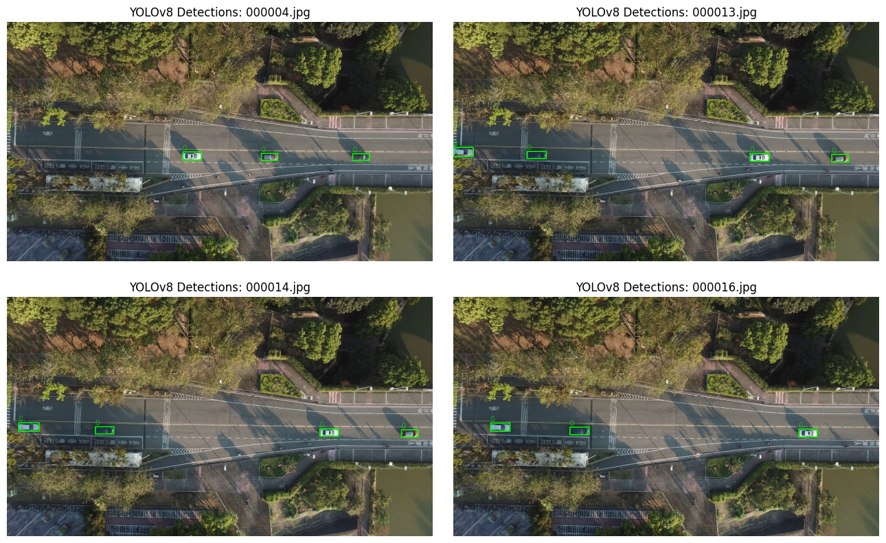

# Aerial Vehicle Detection

**YOLOv8 vehicle detection and classification in aerial (drone) imagery, fine-tuned on the VAID dataset.**

[](https://github.com/RashiChauhan67/aerial-vehicle-detection/actions/workflows/ci.yml)
[](LICENSE)


[Overview](#overview) · [Quick start](#quick-start) · [Dataset](#dataset) · [Results](#results) · [Notes](#notes)

## Overview

The detector finds vehicles in top-down drone images and classifies them into seven types: sedan, minibus, truck, pickup, bus, cement truck and trailer. It fine-tunes a pretrained **YOLOv8m** model.

This repository has thin, tested wrappers around Ultralytics (dataset configuration, training, prediction, validation), a dataset check that flags classes missing from a split, the original experiment notebook, and the recorded results.

| | |
|---|---|
| Task | object detection, 7 vehicle classes |
| Model | YOLOv8m (25.8 M parameters, 78.7 GFLOPs fused) |
| Training | 20 epochs, image size 640, batch size 16 (one Tesla T4) |
| Validation | precision 0.942, recall 0.980, mAP50 0.995, mAP50-95 0.851 |
| Inference | about 7.4 ms per image on a T4 |
| Dataset | VAID, YOLO format |

The metrics are the values recorded in the notebook, from a small validation set.

## Quick start

```bash
git clone https://github.com/RashiChauhan67/aerial-vehicle-detection.git
cd aerial-vehicle-detection
python -m venv .venv && source .venv/bin/activate
pip install -e .
```

Check the dataset, train, evaluate and predict:

```bash
# Instances per class in every split, with warnings for classes missing from valid or test
python scripts/check_dataset.py --dataset-root /path/to/aerial_images

# Fine-tune YOLOv8m (20 epochs, 640 px, batch 16 by default)
python scripts/train.py --dataset-root /path/to/aerial_images --device 0

# Validate on the validation or test split
python scripts/evaluate.py --weights runs/vaid-train/weights/best.pt \
    --dataset-root /path/to/aerial_images --split val

# Detect vehicles; saves annotated images and label files with confidence scores
python scripts/predict.py --weights runs/vaid-train/weights/best.pt --source /path/to/images
```

The scripts build the Ultralytics `data.yaml` for you from the dataset folder.

Use it from Python:

```python
from vehicle_detection.dataset import check_split_coverage
from vehicle_detection.inference import predict

print(check_split_coverage("aerial_images")["warnings"])
predict("runs/vaid-train/weights/best.pt", "aerial_images/test/images")
```

## Dataset

VAID (Vehicle Aerial Imaging from Drone), in YOLO format with `train`, `valid` and `test` splits, each with `images/` and `labels/` folders. Seven classes, in label order: sedan, minibus, truck, pickup, bus, cement truck, trailer. Data is not included; see [`data/README.md`](data/README.md).

## Results

Results from the original experiment notebook. Details are in [`results/recorded_results.md`](results/recorded_results.md).

Validation after training (49 images, 152 labelled vehicles):

| Class | Images | Instances | Precision | Recall | mAP50 | mAP50-95 |
|---|---|---|---|---|---|---|
| **all** | 49 | 152 | 0.942 | 0.980 | 0.995 | 0.851 |
| sedan | 48 | 124 | 0.976 | 0.984 | 0.994 | 0.802 |
| minibus | 11 | 15 | 0.981 | 1.000 | 0.995 | 0.894 |
| truck | 5 | 5 | 0.950 | 1.000 | 0.995 | 0.808 |
| pickup | 5 | 7 | 1.000 | 0.915 | 0.995 | 0.757 |
| bus | 1 | 1 | 0.803 | 1.000 | 0.995 | 0.995 |
| cement truck | 0 | 0 | not evaluated | | | |
| trailer | 0 | 0 | not evaluated | | | |

Example detections on test images from the notebook run:



## Notes

- `predict` saves confidence scores alongside the boxes.
- The fast tests need no PyTorch or dataset and run in CI. An opt-in integration test (`RUN_YOLO_INTEGRATION=1 pytest`) trains, validates and predicts with a tiny YOLOv8n model on a synthetic dataset.

## Repository structure

```
.
├── src/vehicle_detection/  # dataset config and checks, training, inference, evaluation
├── scripts/                # check_dataset.py, train.py, evaluate.py, predict.py
├── tests/                  # unit tests plus an opt-in Ultralytics integration test
├── notebooks/              # original experiment notebook
├── results/                # recorded notebook results and figures
└── data/README.md          # dataset instructions
```

Development: `pip install -e ".[dev]"`, then `ruff check .` and `pytest`.

## License

MIT. See [LICENSE](LICENSE). The dataset has its own license; check it before reuse. Ultralytics YOLO is licensed separately (AGPL-3.0 or an enterprise license); check its terms before you ship a product built on it.
